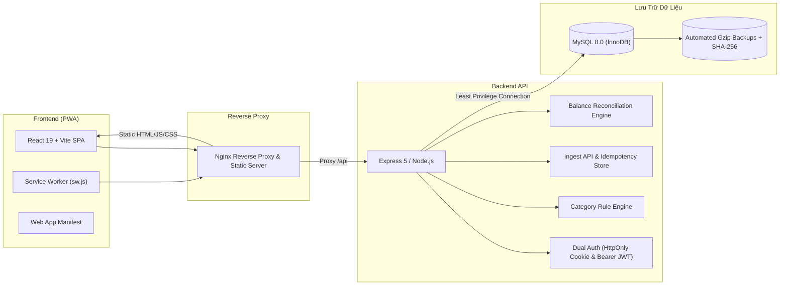

# Finance Tracker - Hệ Thống Quản Lý Tài Chính Cá Nhân

Hệ thống theo dõi và quản lý tài chính cá nhân toàn diện, kết hợp tự động hóa thu thập biến động số dư ngân hàng (Ingest API), phân loại chi tiêu thông minh, nhập sao kê CSV đa định dạng, đối soát số dư ACID và ứng dụng Web cấp tiến (Progressive Web App - PWA) hỗ trợ cài đặt đa nền tảng (Desktop & Mobile).

---

## 📑 Mục Lục
1. [Kiến Trúc & Công Nghệ](#-kiến-trúc--công-nghệ)
2. [Bảng Môi Trường & Địa Chỉ Dịch Vụ](#-bảng-môi-trường--địa-chỉ-dịch-vụ)
3. [Cài Đặt & Khởi Động Nhanh (Local Development)](#-cài-đặt--khởi-động-nhanh-local-development)
4. [Quản Lý Biến Môi Trường & Bí Mật (Secrets)](#-quản-lý-biến-môi-trường--bí-mật-secrets)
5. [Quản Trị Cơ Sở Dữ Liệu & Migrations](#-quản-trị-cơ-sở-dữ-liệu--migrations)
6. [Quy Trình Sao Lưu & Phục Hồi Dữ Liệu (Backup & Restore)](#-quy-trình-sao-lưu--phục-hồi-dữ-liệu-backup--restore)
7. [Giám Sát Hệ Thống & Nhật Ký Vận Hành (Monitoring & Logging)](#-giám-sát-hệ-thống--nhật-ký-vận-hành-monitoring--logging)
8. [Triển Khai Môi Trường Production (Docker, Nginx & Systemd)](#-triển-khai-môi-trường-production-docker-nginx--systemd)
9. [Ứng Dụng Di Động PWA (Progressive Web App)](#-ứng-dụng-di-động-pwa-progressive-web-app)
10. [Kiểm Thử Toàn Diện (Acceptance Test Suite)](#-kiểm-thử-toàn-diện-acceptance-test-suite)

---

## 🏗 Kiến Trúc & Công Nghệ



- **Frontend**: React 19, Vite 6+, React Router 7, Recharts, Responsive Modern CSS, Service Worker PWA (Cache bypass cho API/Auth, cập nhật phiên bản tức thì qua `SKIP_WAITING`).
- **Backend**: Node.js, Express, Rate Limiter, Helmet Security Headers, CORS Policy Strict Whitelist, Dual Authentication (Cookie HttpOnly + Authorization Header Bearer JWT fallback cho Mobile & cURL).
- **Database**: MySQL 8.0 với engine InnoDB, Foreign Keys ràng buộc chặt chẽ, Versioned Migrations tự động, tính toán tiền tệ bằng BigInt nguyên vẹn (ngăn ngừa sai số số thực `float/double`).

---

## 🌐 Bảng Môi Trường & Địa Chỉ Dịch Vụ

| Môi Trường | URL Frontend | URL API Backend | Ghi Chú |
| :--- | :--- | :--- | :--- |
| **Local Dev** | `http://localhost:5173` | `http://localhost:5000/api` | Môi trường phát triển cục bộ, Vite HMR |
| **Staging** | `https://staging-finance.yourdomain.com` | `https://staging-api.yourdomain.com/api` | Môi trường tiền kiểm thử, xác thực giống 100% production |
| **Production** | `https://finance.yourdomain.com` | `https://api.finance.yourdomain.com/api` (hoặc `/api` qua reverse proxy) | Môi trường chính thức chạy dưới Nginx + HTTPS + Docker/Systemd |

---

## 🚀 Cài Đặt & Khởi Động Nhanh (Local Development)

### Yêu cầu tiên quyết
- **Node.js**: Phiên bản 20.x hoặc 22.x LTS.
- **MySQL**: 8.0 trở lên.
- **Git** và terminal (PowerShell trên Windows hoặc Bash trên Linux/macOS).

### 1. Khởi tạo Cơ sở dữ liệu
Đăng nhập MySQL và tạo database:
```sql
CREATE DATABASE IF NOT EXISTS finance_tracker CHARACTER SET utf8mb4 COLLATE utf8mb4_unicode_ci;
```

### 2. Cấu hình và chạy Backend
```powershell
cd backend
npm install
cp .env.example .env
# Chỉnh sửa file .env với thông tin kết nối MySQL và cấu hình bảo mật
npm run db:migrate   # Chạy tự động toàn bộ migration
npm run dev          # Chạy server với chế độ reload tự động
```
> Server backend sẽ lắng nghe tại `http://localhost:5000`.

### 3. Cấu hình và chạy Frontend
Mở một cửa sổ terminal mới:
```powershell
cd frontend
npm install
cp .env.example .env
npm run dev
```
> Giao diện web sẽ khởi chạy tại `http://localhost:5173`. Mở trình duyệt và truy cập để sử dụng ứng dụng.

---

## 🔐 Quản Lý Biến Môi Trường & Bí Mật (Secrets)

Toàn bộ thông số bảo mật bắt buộc phải được khai báo trong file `backend/.env`. Hệ thống áp dụng cơ chế **Fail-Fast Validation** (`backend/config/env.js`) - máy chủ sẽ từ chối khởi động nếu thiếu hoặc cấu hình bí mật không đủ an toàn.

### Các biến môi trường bắt buộc (`backend/.env`):

| Biến Môi Trường | Ý Nghĩa & Yêu Cầu | Giá Trị Mẫu Khuyến Nghị |
| :--- | :--- | :--- |
| `NODE_ENV` | Môi trường thực thi (`development`, `staging`, `production`) | `production` |
| `PORT` | Cổng dịch vụ lắng nghe | `5000` |
| `DB_HOST` | Địa chỉ máy chủ MySQL | `127.0.0.1` |
| `DB_PORT` | Cổng MySQL | `3306` |
| `DB_USER` | Tên tài khoản database (Khuyến nghị dùng user có quyền tối thiểu) | `finance_app` |
| `DB_PASSWORD` | Mật khẩu tài khoản database | `StrongPass_2026!` |
| `DB_NAME` | Tên cơ sở dữ liệu | `finance_tracker` |
| `DB_SSL` | Bắt buộc mã hóa SSL/TLS cho kết nối DB trên production | `true` (hoặc `false` cho local) |
| `JWT_SECRET` | Khóa bí mật ký JWT (**Bắt buộc tối thiểu 32 ký tự**) | Tạo bằng `openssl rand -hex 32` |
| `INGEST_TOKEN` | Token xác thực API tự động hóa Ingest (**Tối thiểu 16 ký tự**) | Tạo bằng `openssl rand -hex 16` |
| `AUTH_PASSWORD_HASH` | Mật khẩu đăng nhập quản trị (Hash bằng bcrypt) | `$2a$10$...` |
| `CORS_ORIGIN` | Danh sách domain được phép gọi API (cách nhau bởi dấu phẩy) | `https://finance.yourdomain.com` |
| `TRUST_PROXY` | Số lượng proxy trung gian phía trước (Nginx, Cloudflare) | `1` |
| `COOKIE_SECURE` | Cờ Secure cho cookie (bắt buộc `true` khi chạy HTTPS) | `true` |
| `COOKIE_SAME_SITE` | Chính sách SameSite cho cookie (`lax`, `strict`, `none`) | `lax` |

> ⚠️ **Quy Tắc Bảo Mật**: Tuyệt đối **KHÔNG** đưa các file `.env` vào kho lưu trữ mã nguồn Git. Các file này đã được bảo vệ trong `.gitignore`.

---

## 🗄 Quản Trị Cơ Sở Dữ Liệu & Migrations

Dự án áp dụng hệ thống di chuyển cấu trúc CSDL theo phiên bản (**Versioned Migrations** độc lập, không phụ thuộc ORM cồng kềnh) lưu vết trong bảng `schema_migrations`.

### 1. Phân Quyền Tối Thiểu (Least Privilege)
Chạy script `database/production_setup.sql` với tài khoản quản trị `root` để tạo user chuyên biệt chỉ có các quyền cần thiết (`SELECT, INSERT, UPDATE, DELETE` trên `finance_tracker`), cô lập hoàn toàn khỏi quyền hệ thống:
```powershell
mysql -u root -p < database/production_setup.sql
```

### 2. Danh Sách Migrations Hiện Có
- `001_initial_schema.sql`: Bảng tài khoản ví (`accounts`), danh mục (`categories`), giao dịch (`transactions`), ngân sách (`budgets`).
- `002_ingest_events.sql`: Bảng lưu vết thông báo ngân hàng thô (`ingest_events`) và cơ chế chống trùng `idempotency_key`.
- `003_category_rules.sql`: Bảng quy tắc tự động gán danh mục theo từ khóa ưu tiên (`category_rules`).
- `004_csv_import_batches.sql`: Bảng quản lý lô nhập sao kê CSV và liên kết giao dịch (`import_batches`).
- `005_reconciliations.sql`: Bảng lịch sử đối soát số dư kỳ vọng và chênh lệch điều chỉnh (`reconciliations`).

### 3. Lệnh Thao Tác Migration (Chạy tại thư mục `backend/` hoặc thư mục gốc):
```powershell
# Xem trạng thái các phiên bản migration
npm run db:status

# Áp dụng các migrations mới chưa chạy
npm run db:migrate

# Hoàn tác lô migration gần nhất (Rollback)
npm run db:rollback
```

---

## 💾 Quy Trình Sao Lưu & Phục Hồi Dữ Liệu (Backup & Restore)

Hệ thống cung cấp bộ công cụ tự động hóa sao lưu và khôi phục toàn vẹn dữ liệu được tích hợp sẵn trong `database/scripts/`.

### 1. Sao Lưu Cơ Sở Dữ Liệu (`backup.js`)
- Tự động nén tệp `.sql.gz` tiết kiệm 80-90% dung lượng.
- Tạo tệp `.meta.json` lưu trữ chi tiết: danh sách bảng, số lượng bản ghi từng bảng, tổng số tiền, thời gian sao lưu.
- Tính toán mã băm **SHA-256 Checksum** để kiểm chứng tính toàn vẹn, chống can thiệp hoặc lỗi bit truyền tải.
- Tự động thực thi chính sách xoay vòng (**Retention Policy**): Tự động xóa các bản sao lưu cũ hơn 7 ngày.

```powershell
# Chạy sao lưu thủ công
npm run db:backup
```
> Tệp sao lưu sẽ được lưu tại: `database/backups/backup_finance_tracker_YYYYMMDD_HHMMSS.sql.gz`.

### 2. Khôi Phục Dữ Liệu An Toàn (`restore.js`)
Quy trình phục hồi dữ liệu tuân thủ chuẩn an toàn cao:
1. **Kiểm tra Checksum SHA-256**: Xác thực tệp không bị hư hỏng trước khi giải nén.
2. **Giải nén & Thực thi**: Nạp schema và dữ liệu vào cơ sở dữ liệu mục tiêu.
3. **Đối chiếu Toàn vẹn Dữ liệu (Post-Restore Verification)**: Tự động so sánh số lượng bảng, số lượng dòng của từng bảng và tổng tiền thực tế với tệp metadata. Báo cáo ngay lập tức nếu có bất kỳ sự sai lệch nào.

```powershell
# Phục hồi vào database chính
npm run db:restore -- --file=database/backups/backup_finance_tracker_20261108_223939.sql.gz

# Phục hồi vào database thử nghiệm độc lập (Staging/Drill)
npm run db:restore -- --file=database/backups/backup_finance_tracker_20261108_223939.sql.gz --target-db=finance_tracker_drill
```

---

## 📊 Giám Sát Hệ Thống & Nhật Ký Vận Hành (Monitoring & Logging)

### 1. Liveness & Readiness Health Probes
Tích hợp sẵn các endpoint chuẩn hóa cho Docker, Kubernetes, Nginx và các dịch vụ giám sát bên ngoài (Uptime Kuma, Prometheus):
- **Liveness Probe** (`GET /health`): Kiểm tra tiến trình Node.js có phản hồi hay không.
  - Phản hồi mẫu: `{"status":"UP","uptime":123.45,"timestamp":"2026-11-08T15:39:39.629Z"}`
- **Readiness Probe** (`GET /health/ready`): Kiểm tra kết nối cơ sở dữ liệu MySQL và độ trễ truy vấn (`ping latency`).
  - Phản hồi mẫu: `{"status":"READY","database":"connected","latency_ms":3}`

### 2. Nhật Ký Vận Hành Có Che Giấu Dữ Liệu Nhạy Cảm (Log Sanitization)
Module `backend/utils/logger.js` tự động che giấu (`[REDACTED]`) các trường thông tin nhạy cảm trước khi ghi ra console hoặc file:
- Mã định danh ủy quyền: `Bearer token`, `JWT token`, `INGEST_TOKEN`.
- Mật khẩu đăng nhập: `password`, `hash`.
- Nội dung tin nhắn ngân hàng thô: `raw_message`, `text`.

---

## 🚢 Triển Khai Môi Trường Production (Docker, Nginx & Systemd)

Chi tiết đầy đủ về kiến trúc triển khai xem tại tài liệu [docs/DEPLOYMENT.md](file:///d:/finance-tracker-project/docs/DEPLOYMENT.md).

### Lựa Chọn 1: Triển Khai Bằng Docker Compose (Khuyến nghị)
Hệ thống đóng gói sẵn mô hình cô lập mạng:
- `public_net`: Chỉ mở cổng 80/443 ra ngoài qua Nginx.
- `internal_net`: Backend và MySQL nằm ở mạng nội bộ khép kín.

```powershell
# 1. Khởi động toàn bộ cụm dịch vụ
docker compose up -d --build

# 2. Xem nhật ký hoạt động
docker compose logs -f backend

# 3. Chạy migration bên trong container
docker compose exec backend npm run db:migrate
```

### Lựa Chọn 2: Triển Khai Trực Tiếp Bằng Systemd Service (Linux Host)
Sử dụng tệp cấu hình mẫu tại `deploy/systemd/finance-tracker-backend.service`:
```bash
sudo cp deploy/systemd/finance-tracker-backend.service /etc/systemd/system/
sudo systemctl daemon-reload
sudo systemctl enable finance-tracker-backend
sudo systemctl start finance-tracker-backend
sudo journalctl -u finance-tracker-backend -f
```

### Cấu Hình Nginx Reverse Proxy & SPA Fallback
Tệp cấu hình Nginx mẫu tại `deploy/nginx/conf.d/default.conf` đã thiết lập tối ưu:
- Hỗ trợ SPA Router: `try_files $uri $uri/ /index.html;`
- Chặn lưu cache cho Service Worker: `sw.js` luôn được cấu hình `Cache-Control: no-cache, no-store, must-revalidate`.
- Tự động đính kèm `X-Forwarded-For` và `X-Forwarded-Proto`.

---

## 📱 Ứng Dụng Di Động PWA (Progressive Web App)

Finance Tracker được tối ưu theo tiêu chuẩn PWA hiện đại:
- **Cài đặt như ứng dụng gốc**: Hỗ trợ thêm vào màn hình chính trên iOS (Safari), Android (Chrome) và Desktop (Chrome/Edge).
- **Trải nghiệm độc lập (Standalone)**: Chạy toàn màn hình, không thanh địa chỉ trình duyệt, hiệu ứng mượt mà.
- **Biểu tượng độ phân giải cao**: Định dạng Web Manifest chuẩn hóa kèm Apple Touch Icon chuẩn Retina.
- **Tự động phát hiện phiên bản mới**: Hiển thị thanh thông báo cập nhật trực tiếp trên giao diện (`PwaContext.jsx`), người dùng chỉ cần nhấn "Cập nhật ngay" để áp dụng phiên bản mới mà không bị dính cache cũ.

---

## 🧪 Kiểm Thử Toàn Diện (Acceptance Test Suite)

Dự án sở hữu bộ kiểm thử tự động toàn diện bao quát 100% các tiêu chí từ Giai đoạn 1 đến Giai đoạn 5:

```powershell
# Chạy bộ kiểm thử nghiệm thu E2E toàn diện (Step 5.5 Acceptance Test)
node scratch/test-step-5-5-e2e.cjs
```

### Kết Quả Kiểm Thử Nghiệm Thu (49/49 PASS - 100%):
- ✅ **Phần 1: Hạ tầng & Bảo mật** (Liveness, Readiness, CORS denial, No-store cache).
- ✅ **Phần 2: Xác thực & Phiên** (Chặn 401 khi chưa login, sai pass, HttpOnly Cookie, Bearer Token fallback).
- ✅ **Phần 3: Nghiệp vụ cốt lõi** (Ví tiền, Danh mục, Giao dịch Thu/Chi/Transfer, Số dư tức thời, Ngân sách cảnh báo, Báo cáo tài chính).
- ✅ **Phần 4: Ingest API** (Bearer token xác thực, Sinh idempotency_key, Chống trùng lặp tuyệt đối).
- ✅ **Phần 5: Hộp chờ duyệt & Phân loại** (Quy tắc tự động gán danh mục ưu tiên, Duyệt Inbox sang giao dịch).
- ✅ **Phần 6: Nhập sao kê CSV** (Preview ma trận cột, Bắt lỗi dòng hỏng, Nhập lô giao dịch lớn).
- ✅ **Phần 7: Đối soát số dư (Reconciliation)** (Phân rã công thức số dư, Phát hiện chênh lệch, Điều chỉnh số dư theo chuẩn giao dịch ACID).
- ✅ **Phần 8: Quản trị Vận hành & CSDL** (Toàn bộ 5 migrations đã áp dụng, Sao lưu gzip nén SHA-256, Phục hồi vào database độc lập và kiểm chứng dữ liệu trùng khớp 100%).

---

## 📄 Bản Quyền & Giấy Phép
Dự án được xây dựng và duy trì bởi đội ngũ phát triển Finance Tracker Project. Phục vụ quản lý tài chính cá nhân an toàn, bảo mật và tin cậy.
